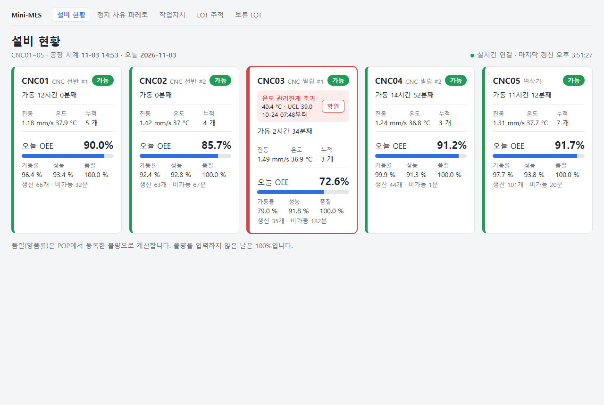
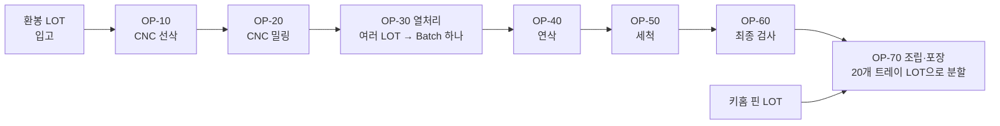
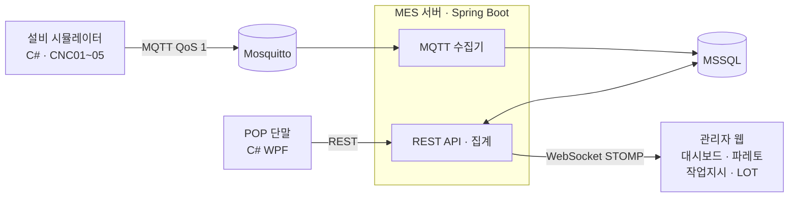
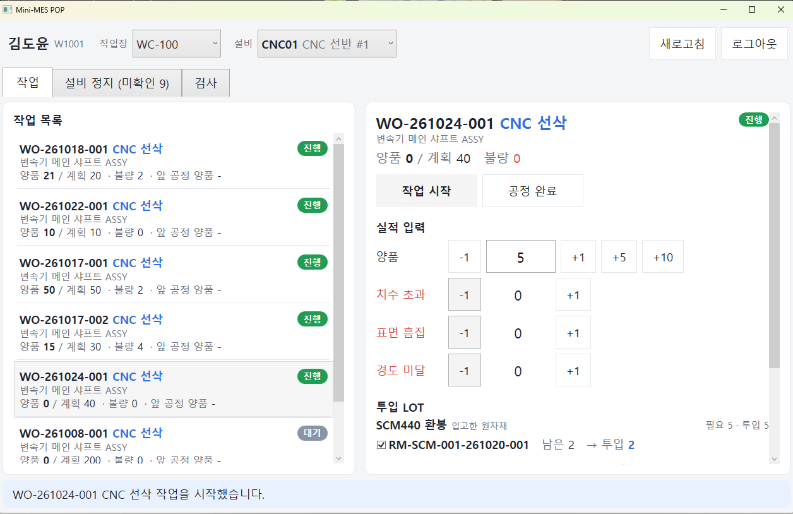
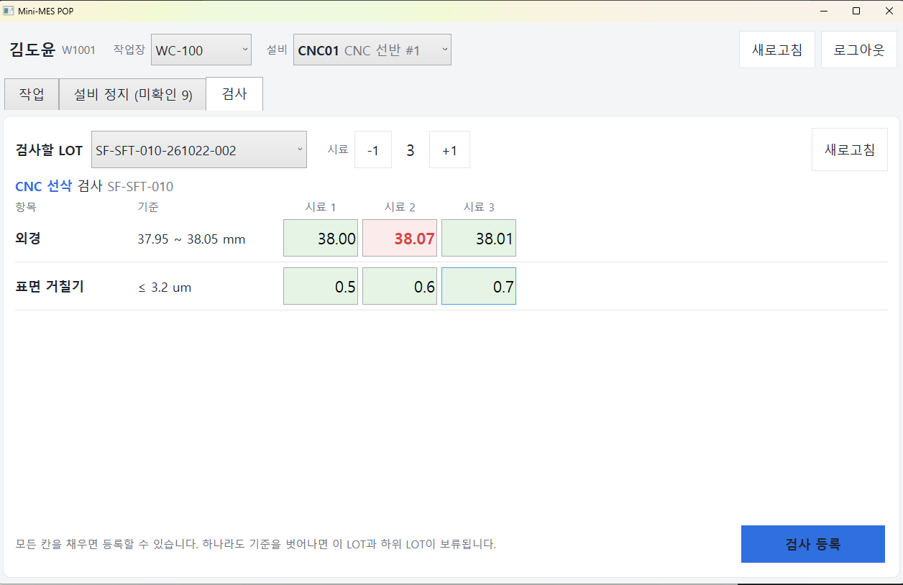
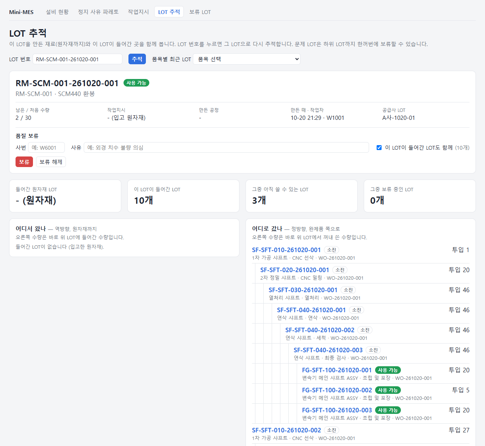
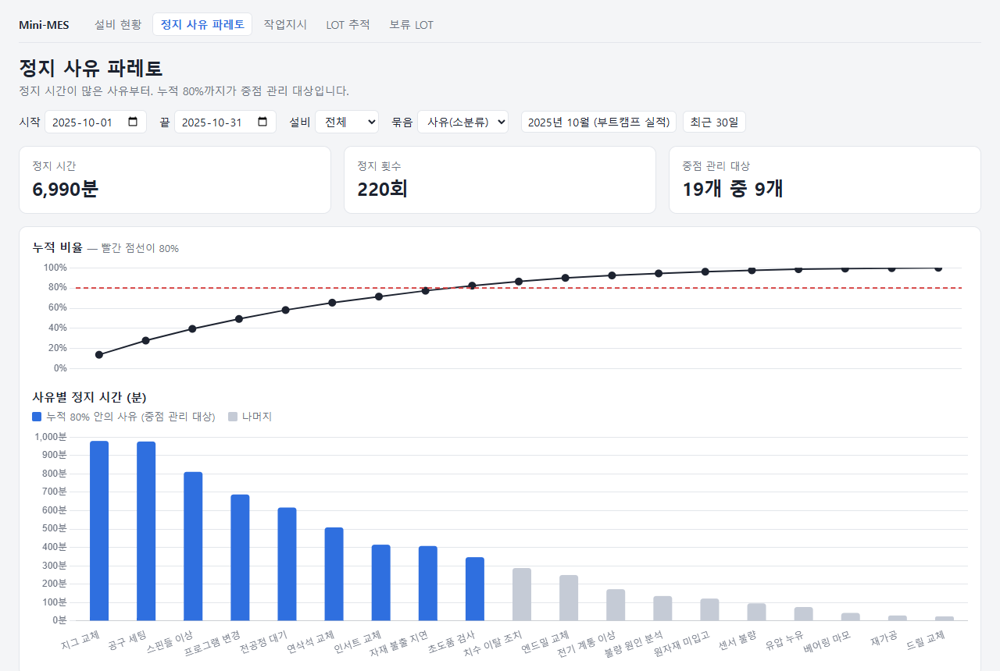
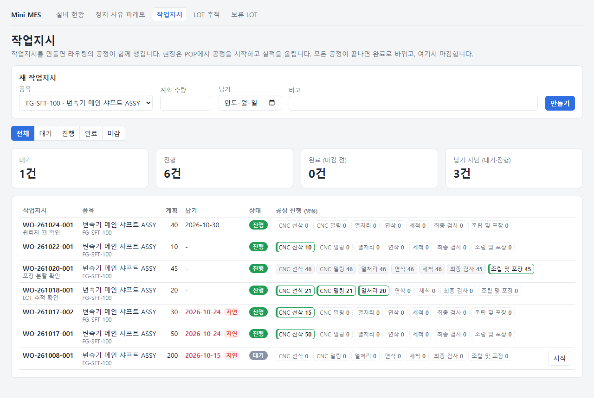
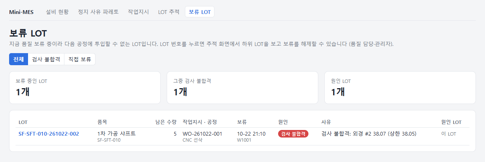

# Mini-MES

자동차 변속기 샤프트를 깎는 CNC 가공 공장(가상 기업)의 MES입니다. 스마트팩토리 부트캠프의 현황 분석 자료에서 찾은 문제를 하나씩 기능으로 풀었습니다.

- **서버**: Java 21, Spring Boot 4, JPA + MyBatis, MSSQL, Thymeleaf + 순수 JS 화면
- **현장 프로그램**: C# .NET 8 — WPF POP 단말(MVVM), 설비 시뮬레이터(MQTT)
- **테스트**: 서버 116개(H2), 실제 MSSQL 통합 테스트 16개(Testcontainers), POP 39개(xUnit)



## 왜 만들었나: 현황 분석 → 기능

부트캠프 1차 자료(업무 시나리오)의 현장 문제를 2차 자료(설비 데이터 한 달치)로 확인하고, 개선 과제 5개 중 셋을 이 프로젝트의 범위로 정했습니다.

| 개선 과제 | 현장 문제 | 데이터 근거 | 만든 기능 |
| --- | --- | --- | --- |
| 제품 추적·품질 역추적 | 공정별 수기 관리로 이력이 끊기고 불량 보고는 종이 | 고객사의 납품 이력 추적 요구 | LOT 발행·병합·분할, 정/역방향 추적, 검사 판정, 품질 보류 |
| 실시간 생산 모니터링 | 종이 작업일보를 다음 날 엑셀에 입력, 작업지시는 구두·화이트보드 | 생산 진도 파악이 하루 늦음 | 작업지시, POP 실적, 설비 자동 수집, 실시간 대시보드 |
| CBM 예방 보전 | 고장은 구두 보고, 수리 이력 누락 | CNC03 OEE 59.18%, 스핀들 이상 정지 811분 | 비가동 기록, OEE, 정지 사유 파레토, 진동·온도 관리한계 알람 |
| 셋업 최적화 | 공구 교체 시점이 작업자 경험에 의존 | 품번 교체·셋업이 정지 사유 1위 | 정지 사유 파레토 (공구 수명 관리는 다음 단계) |
| 자재 청구 자동화 | 자재 불출을 구두·메신저로 요청 | 재고 오차 10~15% | 원자재 LOT 입고까지 (불출·재고는 범위 밖) |

OEE는 2차 자료의 계산 방식(시간·수량을 합산한 뒤 비율 계산)을 그대로 따르고, 엑셀 정답값(2025년 10월 CNC01 84.24%, CNC03 59.18%)과 같은지 MSSQL 통합 테스트로 확인합니다.

## 공정과 데이터 흐름

제품 하나(FG-SFT-100 변속기 메인 샤프트)를 7개 공정으로 만듭니다.





- 설비 시뮬레이터는 2차 자료의 사이클타임과 실제 정지 기록을 재현해 상태·카운트·진동·온도를 보냅니다. 보내지 못한 메시지는 SQLite에 쌓았다가 다시 보냅니다.
- 서버는 메시지를 저장하고 상태 이력·비가동을 기록하며, 매일 생산 실적과 OEE를 집계합니다. 바뀐 내용은 1초 안에 대시보드로 보냅니다.
- 작업자는 POP에서 공정을 시작하고 양품·불량과 투입 LOT을 등록합니다. 실적 하나가 투입 LOT을 줄이고 새 LOT을 만들어 계보로 잇습니다.

## 주요 기능

### 현장 POP (C# WPF)



- 작업장의 작업 목록 → 작업 시작 → 양품·불량 입력 → 투입 LOT 확인 → 실적 등록 → 공정 완료
- 수량을 넣으면 먼저 들어온 LOT부터 필요한 만큼 자동으로 체크됩니다 (선입선출).
- 실적은 보내기 전에 단말 파일에 적어 둡니다. 응답을 못 받거나 POP가 꺼져도 같은 요청 ID로 다시 보내므로 실적이 두 번 생기지 않습니다.
- [설비 정지] 탭에서 설비가 남긴 정지에 사유를 확정하면 파레토에 바로 반영됩니다.



- [검사] 탭: LOT을 만든 공정의 검사 항목을 시료 여러 개로 잽니다. 서버가 하한·상한으로 판정하고, 하나라도 불합격이면 그 LOT과 하위 LOT을 자동으로 보류합니다.

### LOT 추적과 품질 보류



- 재귀 CTE 한 번으로 역방향(이 LOT을 만든 원자재까지)과 정방향(이 LOT이 들어간 완제품까지)을 따라갑니다.
- 열처리는 여러 LOT을 Batch 하나로 합치고, 포장은 20개 트레이 단위로 나눕니다. 둘 다 같은 계보 테이블(투입 → 산출)로 표현합니다.
- 문제 LOT을 하위 LOT까지 한꺼번에 보류하면 보류한 LOT은 투입할 수 없습니다. 해제는 품질 담당·관리자만 합니다.

### 모니터링과 분석



- 설비 현황: 상태, 진행 중인 정지 사유, 센서값, 오늘 OEE를 실시간으로 보여 주고, 연결이 끊기면 5초 조회로 바꿉니다.
- 관리한계 알람: 정상 가동 데이터로 진동·온도의 UCL(평균 + 3σ)을 정해 두고, 넘으면 알람을 띄웁니다.
- 정지 사유 파레토: 누적 80%까지를 중점 관리 대상으로 표시합니다.

### 관리자 웹





## 기술적으로 고민한 것

| 문제 | 해결 |
| --- | --- |
| 응답을 못 받은 POP가 다시 보내면 실적이 두 번 생김 | POP가 만든 요청 ID에 UNIQUE 제약. 같은 ID면 처음 결과를 돌려줌. 보내기 전에 단말 파일에 적어 POP가 꺼져도 같은 ID로 재전송 |
| 통신이 끊긴 동안의 설비 데이터 유실 | 시뮬레이터가 SQLite outbox에 쌓고 재전송, 서버는 messageId로 중복 제거, MQTT 영속 세션(QoS 1) |
| 두 단말이 같은 LOT을 동시에 투입하면 수량이 틀어짐 | 투입 LOT을 `UPDLOCK`으로 잠그고 읽음. 뒤 요청은 앞 요청이 커밋할 때까지 기다렸다가 줄어든 수량을 읽음 |
| 깊이를 모르는 LOT 계보 추적 | MyBatis 재귀 CTE. 취소한 실적의 계보는 지우지 않고 추적 쿼리에서 거름 |
| 보류 대상을 추적하는 사이 다른 실적이 하위 LOT을 만듦 | 대상 LOT을 잠근 뒤 다시 추적하고, 새로 나온 LOT이 없을 때까지 반복 |
| 관리한계를 새 데이터로 자동 갱신하면 서서히 나빠지는 설비를 놓침 | 한계를 기준 기간·표본 수와 함께 저장하고 자동으로 바꾸지 않음 |
| H2 테스트로는 MSSQL 전용 쿼리(재귀 CTE, `OUTER APPLY`, 계산 컬럼)를 확인할 수 없음 | Testcontainers로 실제 MSSQL을 띄우고 저장소의 DDL·seed를 그대로 실행한 뒤, `ddl-auto: validate`로 엔티티와 테이블이 맞는지까지 확인 |

결정마다의 이유와 검토한 대안은 [docs/decisions.md](docs/decisions.md)에 있습니다.

## 실행 방법

필요한 것: Docker Desktop, JDK 21, .NET 8 SDK (POP는 Windows)

```bash
# 1. DB와 MQTT 브로커
cp .env.example .env          # DB 비밀번호
docker compose up -d
#    처음 한 번 DDL과 seed를 넣습니다: db/README.md 참고

# 2. 서버 → http://localhost:8080 (관리자 웹), /swagger-ui.html (API)
cd server && ./gradlew bootRun

# 3. 설비 시뮬레이터 (60배속: 현실 1초 = 공장 1분)
dotnet run --project simulator/MiniMes.Simulator -- --speed 60

# 4. POP (사번 W1001 선삭, W2001 밀링, W6001 품질, W9001 관리자)
dotnet run --project pop/MiniMes.Pop
```

## 테스트

```bash
cd server && ./gradlew test               # H2, 116개
cd server && ./gradlew integrationTest    # 실제 MSSQL (Docker 필요), 16개
dotnet test pop/MiniMes.Pop.Tests         # POP 화면 로직, 39개
```

## 구성

| 폴더 | 내용 | 기술 |
| --- | --- | --- |
| [`server/`](server/README.md) | MES 서버: 기준정보, 작업지시, 실적, LOT, 검사, 수집, OEE, 관리자 웹 | Java 21, Spring Boot 4, JPA, MyBatis, Thymeleaf |
| [`pop/`](pop/README.md) | 현장 POP 단말: 작업, 설비 정지, 검사 | C# .NET 8, WPF (MVVM, CommunityToolkit), xUnit |
| `simulator/` | 설비 CNC01~05 시뮬레이터 | C# .NET 8, MQTTnet, SQLite |
| [`db/`](db/README.md) | DDL, seed SQL | MSSQL |
| [`data/master/`](data/master/README.md) | 기준정보 CSV (품목, BOM, 라우팅, 설비, 검사 규격, 작업자) | CSV |
| `tools/` | 부트캠프 엑셀과 CSV를 검증해 seed SQL로 바꾸는 스크립트 | Python |
| `infra/` | MQTT 브로커 설정 | Mosquitto |
| `docs/` | [ERD](docs/erd.md), [기술 결정](docs/decisions.md), 화면 캡처 | Markdown |

부트캠프 원본 엑셀은 실제 거래처 이름이 들어 있어 저장소에 넣지 않았습니다. 기준정보는 CSV로 옮겨 이름을 바꿨습니다.
