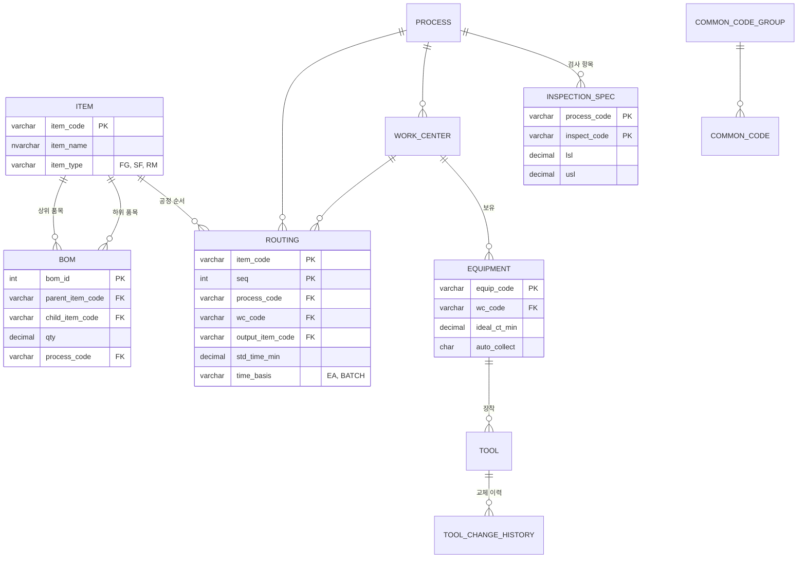
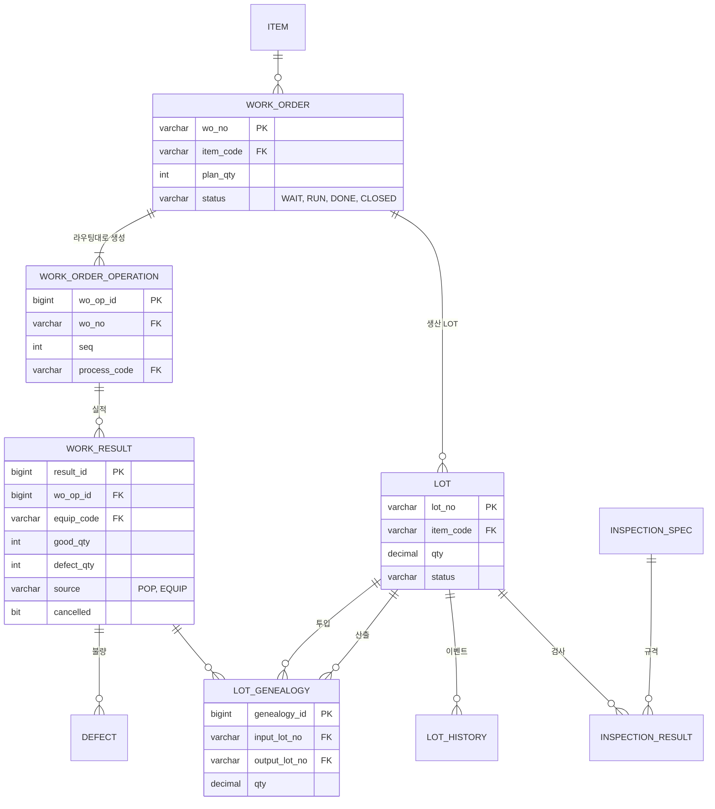
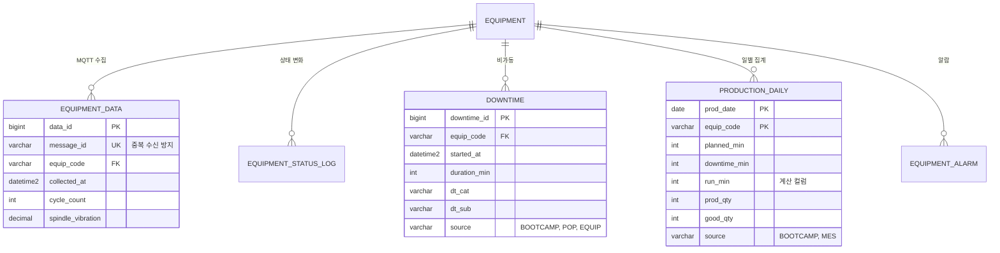

# ERD

DDL은 [`db/ddl/`](../db/ddl)에 있습니다. 테이블 25개, 뷰 2개이며 다섯 영역으로 나뉩니다.
아래 그림은 키와 관계 위주로 줄인 것이고, 전체 컬럼은 DDL을 참고하세요.

## 1. 기준정보

## 2. 생산과 LOT 추적

## 3. 설비

## 설계 포인트

| 결정 | 이유 |
| --- | --- |
| LOT 관계를 `lot_genealogy`(투입 → 산출) 한 테이블로 표현 | 열처리 Batch 병합(N → 1)과 포장 분할(1 → N)을 같은 구조로 다루고, 재귀 CTE 하나로 정/역방향 추적 |
| 실적은 수정 없이 `cancelled` 표시 | 누가 언제 실적을 바꿨는지 감사 추적 가능 |
| `equipment_data.message_id` 유니크 | 시뮬레이터가 통신 장애 뒤 재전송해도 중복 저장되지 않음 |
| `production_daily`에 부트캠프 실적과 MES 집계를 함께 저장 | OEE를 같은 뷰(`v_oee_daily`, `v_oee_monthly`)로 계산해 엑셀 결과와 비교 |
| 월별 OEE는 일별 OEE의 평균이 아니라 합산 후 계산 | 부트캠프 2차 자료의 STEP 4 방식과 맞춤 |
| BOM Level 미저장 | 원본의 Level 번호 오류를 반복하지 않고 재귀 CTE로 계산 |
| 3단계 기능(자재 재고)은 아직 테이블 없음 | 1~2단계 완성 후 추가 |
